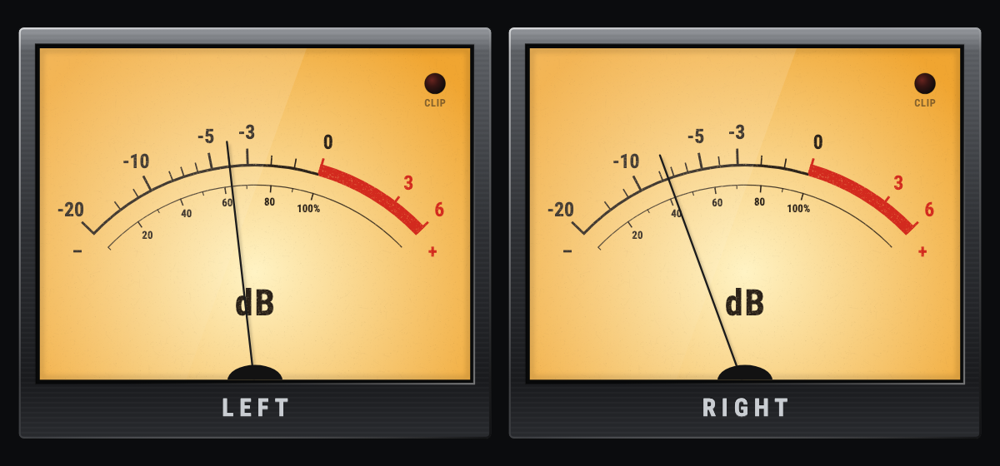
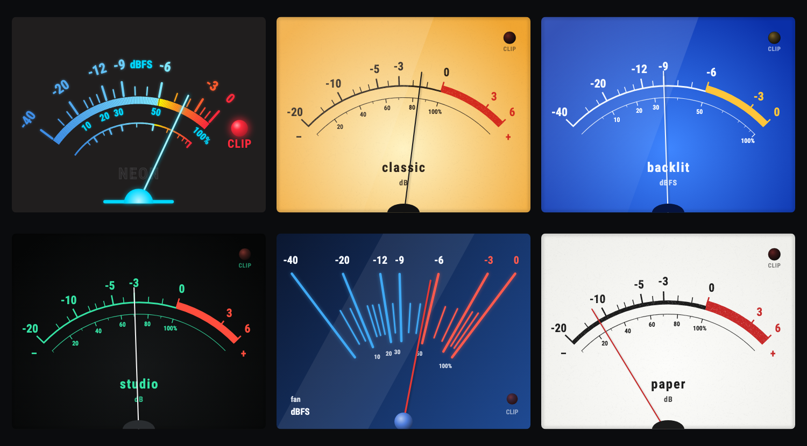
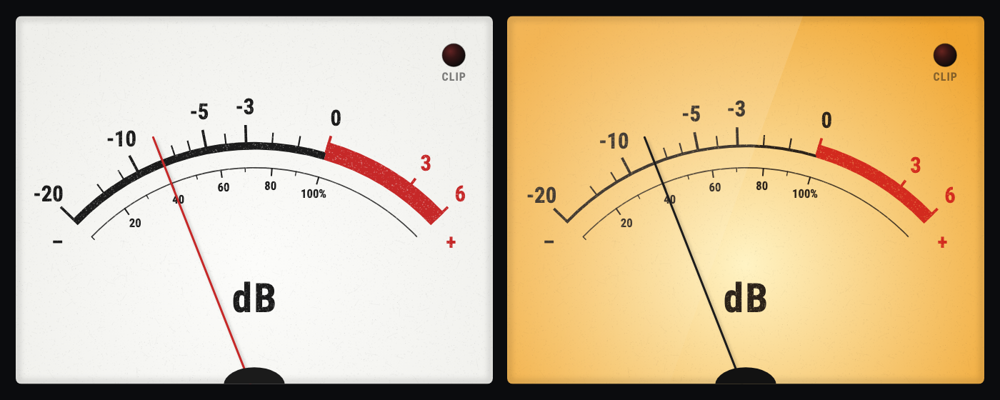
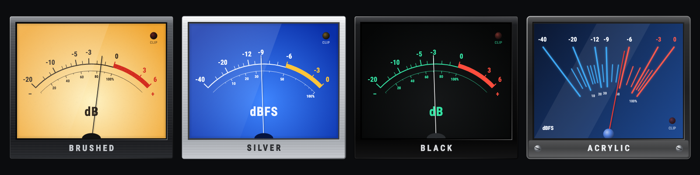
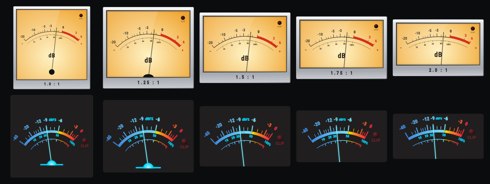

# analog_vu_meter

Analog needle meters for Flutter: six faces, four frames, any scale.



* **Faces** — `neon`, `classic`, `backlit`, `studio`, `fan`, `paper`; every
  colour can be changed, and you can paint your own
* **Frames** — `brushed`, `silver`, `black`, `acrylic`, or none; every frame
  fits every face
* **Scales** — analog (−20 … +6 dB), digital (−40 … 0 dBFS) or your own;
  every scale works on every face
* clip lamp with tap callback, optional label, percent scale; the minus and
  plus at the ends of the scale can be turned off (`showSigns: false`)
* needle ballistics: the needle travels to a new level like a real one
* painted in pure Dart — no assets, no dependencies
* the dial is painted once; only the needle repaints

## Usage

```dart
import 'package:analog_vu_meter/analog_vu_meter.dart';

VuMeter(db: -3)
```

`db` is the level on the dial's scale.

### Faces

```dart
VuMeter(db: level, face: VuFace.classic)
```

| | |
|---|---|
| `VuFace.neon` (default) | dark dial, glowing blue scale and needle |
| `VuFace.classic` | the warm, backlit studio VU meter |
| `VuFace.backlit` | white on blue, a backlit power meter |
| `VuFace.studio` | mint green on black |
| `VuFace.fan` | a fan of blue rays, red needle |
| `VuFace.paper` | plain black on white |



The paper and the classic face look printed: the paper shows its tooth, the
ink has pinholes and slightly ragged edges. That is optional —
`ArcVuFace.classic(grain: 0)` gives the clean drawing, any value up to 1 a
lighter print, and the other arc faces take `grain` as well.



`VuFace.values` lists them, e.g. for a picker. To recolour one, construct it:

```dart
VuMeter(
  db: level,
  face: const ArcVuFace.classic(
    faceCentre: Color(0xFFE9F5D8), // a pale green dial
    faceEdge: Color(0xFFB9D49A),
  ),
)
```

For a face of your own extend `VuFace` and paint dial, lamp and needle.

### Frames

```dart
VuMeterBezel(
  style: VuBezelStyle.silver,
  caption: 'LEFT',
  child: VuMeter(db: level, face: VuFace.classic),
)
```

`VuBezelStyle.brushed` (default), `.silver`, `.black`, `.acrylic` — or leave
the bezel away. The window takes the shape of the meter in it; the shape of
the whole frame is `VuMeterBezel.aspectRatioFor(meter.aspectRatio)`.



### Scales

| | range | hot zone | for |
|---|---|---|---|
| `VuScale.analog` (default) | −20 … +6 dB | above 0 dB | levels with headroom above nominal |
| `VuScale.digital` | −40 … 0 dBFS | the last 6 dB | digital levels — nothing exists above full scale |
| `VuScale.even(...)` | yours | yours | anything else |

A digital peak or RMS value is measured against full scale. With the digital
scale the needle ends at 0 dBFS and the red zone means "about to clip":

```dart
VuMeter(
  scale: VuScale.digital,
  db: VuScale.dbFromAmplitude(peak), // 1.0 is 0 dBFS
  clip: peak >= 1.0,
  onClipTap: resetClip,
)
```

On the analog scale, decide where full scale should sit — for instance on
the last mark, with the hot zone starting 6 dB below:

```dart
VuMeter(db: VuScale.dbFromAmplitude(peak, referenceDb: 6))
```

Your own scale, evenly spread:

```dart
VuMeter(
  db: level,
  scale: VuScale.even(
    levels: [-60, -48, -36, -24, -12, 0],
    minorTicks: 1,
    hotFromDb: -12,
    unit: 'dBFS',
  ),
)
```

Or place every mark yourself — a scale is a list of `(level, position)`
with positions from 0 to 1:

```dart
const VuScale(
  marks: [(-10, 0), (-5, 0.7), (0, 1)],
  majorDb: [-10, -5, 0],
  hotFromDb: -5,
  silenceDb: -20,
  unit: 'VU',
)
```

### Ballistics

`response` is the time the needle needs to (almost) reach a new level. The
default of 300 ms is the classic VU behaviour. Pass `Duration.zero` if you
smooth the level yourself.

### Size

A meter keeps its `aspectRatio` and takes the width it is given. The default
is the shape the faces were drawn for (`VuFace.aspectRatio`, about 1.3 : 1);
anything from 1 : 1 to 2 : 1 works:

```dart
VuMeter(db: level, aspectRatio: 2)
```

A face is never stretched to its shape — letters and circles keep their
proportions. It is laid out again: the wider the meter, the flatter its arc
and the lower the pivot of its needle. On a wide meter the pivot lies below
the window, where a frame hides it, as on a panel meter.



## Example

`example/` holds a small app with two meters fed by a made-up signal; its
buttons step through faces, frames, shapes and scales.

```sh
cd example
flutter run
```

## Credits

Artwork and widget by Oliver Brackelmann, designed and built together with
[Claude Code](https://claude.com/claude-code).
